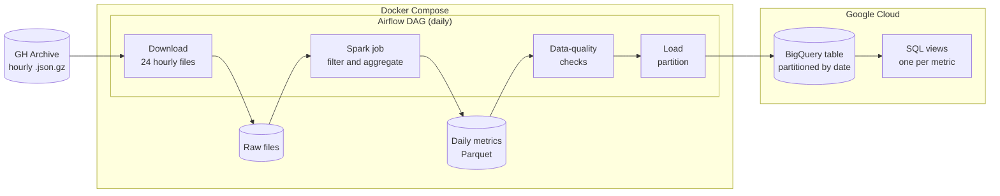
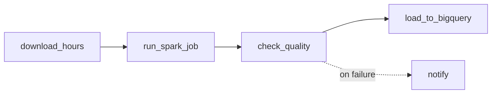
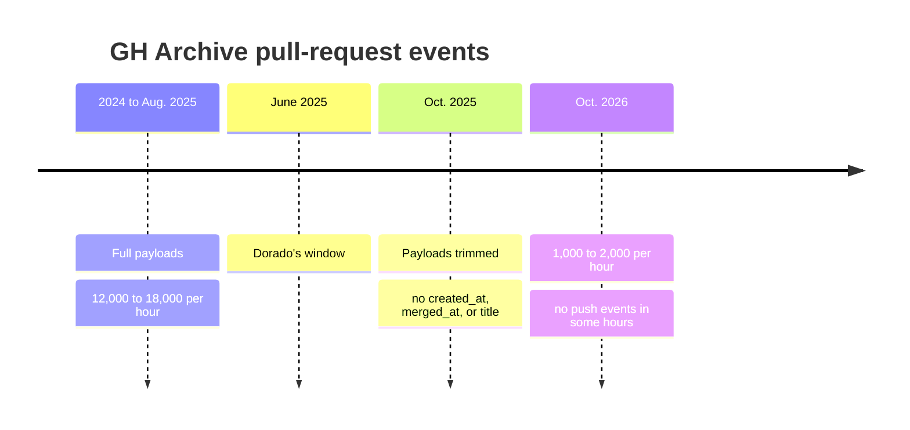
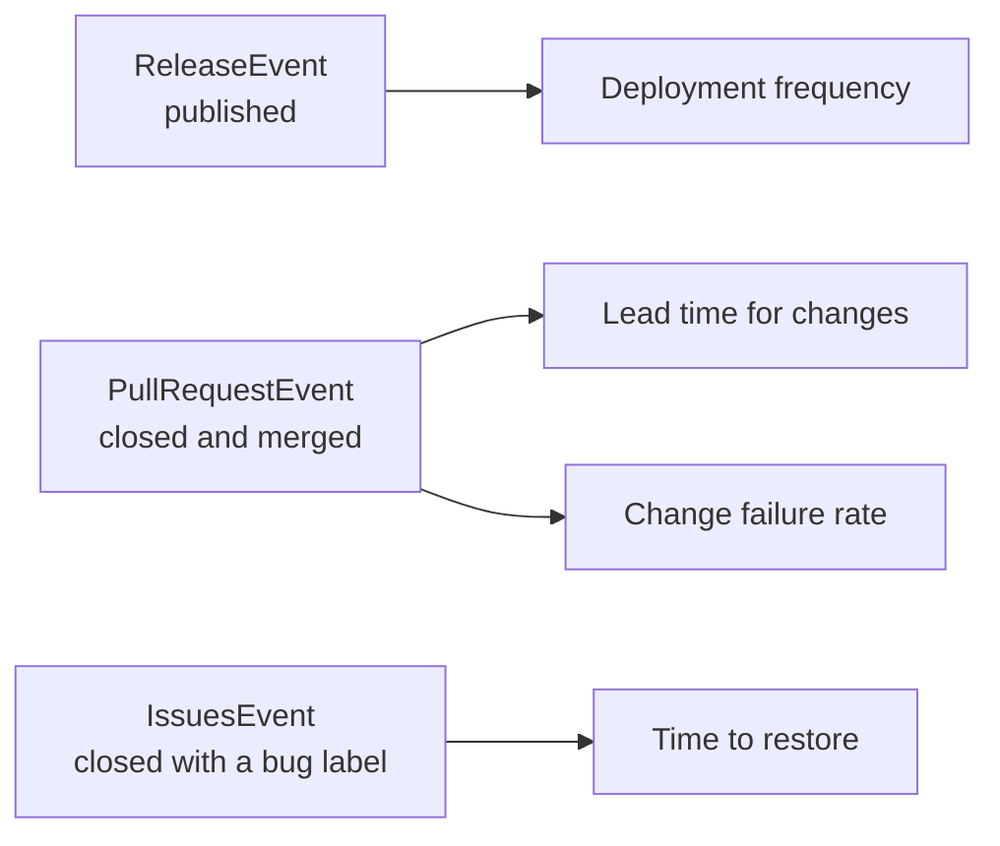

# Dorado

Dorado is a daily batch pipeline that computes the four DORA metrics for a handful of well-known open-source repositories. It reads the public [GH Archive](https://www.gharchive.org/) event stream, aggregates it with PySpark, checks the result, and loads it into BigQuery. Airflow schedules and backfills the runs.

The DORA metrics measure how a team delivers software:

| Metric | Question it answers |
| --- | --- |
| Deployment frequency | How often does the project ship? |
| Lead time for changes | How long does a change take from proposal to merge? |
| Change failure rate | How often does a change need to be undone or fixed? |
| Time to restore | How long does it take to resolve a reported bug? |

## Architecture



All heavy lifting happens locally. Spark reads a full day of raw events, keeps only the configured repositories, and writes a few hundred rows of daily aggregates. Only those aggregates travel to BigQuery. The pipeline never queries the public `githubarchive` dataset in BigQuery, so it stays within the free sandbox.

Each daily run is one Airflow task chain:



A failed check stops the run before anything reaches BigQuery. Each load replaces exactly one date partition, so rerunning or backfilling a day never duplicates data.

## Repository layout

| Path | Contents |
| --- | --- |
| `src/dorado/` | The Python package: Spark session, transformations, checks, and loader |
| `tests/` | pytest suite with small JSON fixtures |
| `dags/` | Airflow DAG definitions |
| `Dockerfile` | Airflow image with Java 17 and PySpark |
| `compose.yaml` | Local Airflow stack |

## Setup

You need Docker with Compose and [uv](https://docs.astral.sh/uv/).

### Run the tests

```bash
uv sync
uv run pytest
```

PySpark needs Java 17 or newer on your `PATH`.

### Start Airflow

```bash
cp .env.example .env   # then fill in the two secrets
docker compose up --build
```

The Airflow UI runs at <http://localhost:8080>. Local login is disabled, so every visitor is an admin. Do not expose this port.

### Google Cloud credentials

Place a service-account key at `secrets/gcp-service-account.json`. Compose mounts the `secrets/` folder read-only, and Git ignores it. The key needs only the BigQuery Data Editor and BigQuery Job User roles on the target dataset.

## Data window

Dorado computes metrics for June 2025, one day per Airflow run. The window is fixed on purpose.

In the fall of 2025, GitHub removed most fields from the public pull-request events. Creation time, merge time, and title are gone. The archive also shrank from about 250,000 events per hour to a few thousand. Data after the change cannot support lead time or change failure rate. The evidence is in [docs/event-schemas.md](docs/event-schemas.md).



## Repositories

| Repository | Bug label |
| --- | --- |
| `kubernetes/kubernetes` | `kind/bug` |
| `grafana/grafana` | `type/bug` |
| `elastic/elasticsearch` | `>bug` |
| `microsoft/vscode` | `bug` |
| `apache/airflow` | `kind:bug` |
| `dotnet/runtime` | `bug` |
| `astral-sh/uv` | `bug` |
| `astral-sh/ruff` | `bug` |

Each one merges pull requests on GitHub and labels its bugs. Projects that merge elsewhere, such as `golang/go` through Gerrit, would show no lead time at all.

## Metric definitions

Every metric comes from one event type. No metric needs to join two events, which keeps the Spark job simple and robust against gaps in the archive.



Each metric is computed per repository and UTC day. A day is the date of the event in the archive.

### Deployment frequency

The number of releases published that day. Drafts and pre-releases do not count.

- Source: `ReleaseEvent` with `release.draft = false` and `release.prerelease = false`.
- Limitation: a GitHub release is not a deployment. Projects that ship from tags or package registries alone are undercounted.

### Lead time for changes

The median time from opening a pull request to merging it, over all pull requests merged that day.

- Source: `PullRequestEvent` with action `closed` and `pull_request.merged = true`. Lead time is `merged_at - created_at`.
- Limitation: DORA measures from commit to production. Dorado measures from proposal to merge, so it leaves out the time between merge and release. It also counts time spent in draft.

### Change failure rate

The share of merged pull requests that undo or patch an earlier change.

- Source: the same merged pull requests. A change counts as a failure fix when its title starts with `Revert`, its branch starts with `revert-`, or its title or branch contains `hotfix`. GitHub's revert button produces the first two patterns.
- Limitation: DORA divides failed deployments by all deployments. Dorado divides corrective changes by all changes. It misses fixes that do not say what they fix.

### Time to restore

The median time from opening a bug report to closing it as completed, over all such issues closed that day.

- Source: `IssuesEvent` with action `closed`, `issue.state_reason = "completed"`, and at least one label whose name contains `bug`, ignoring case. Time to restore is `closed_at - created_at`.
- Limitation: DORA measures recovery from a production incident. A bug report is a weaker signal. Old backlog bugs closed in a cleanup inflate the value, which is why Dorado reports the median rather than the mean.

### Coverage

GH Archive records the public GitHub event stream, which has always missed some events. All counts are therefore lower bounds. The medians hold up better. As long as events go missing at random, a gap removes samples without shifting the middle.

## Dashboard

<!-- Screenshot placeholder: add docs/dashboard.png once the views are in place. -->

## Design decisions

- Spark in local mode. One day of GH Archive is a few gigabytes. A single machine handles it, so a Spark cluster would add network setup and version matching for no gain. The same code would run on a cluster by changing the master URL.
- LocalExecutor instead of Celery. Celery workers and Redis pay off across several machines. Here the scheduler runs tasks as local subprocesses.
- Aggregate locally, load results. Uploading a few hundred rows instead of raw events keeps the BigQuery footprint, and the bill, near zero.
- A fixed historical window. GitHub trimmed the event payloads in the fall of 2025. Rather than build fragile workarounds on thin data, Dorado backfills June 2025, when every needed field still existed. Airflow treats this as an ordinary backfill with a start and an end date.
- One event per metric. Each metric reads a single event type, so no metric joins an opening event to a closing one. A join would fail whenever the archive missed one side.
- Medians, not means. Lead time and time to restore have long tails. One bug fixed after three years would dominate a mean.
- Idempotent partition loads. Each run overwrites one date partition. Backfills and retries are therefore safe to repeat.
- Airflow constraints in the image. Airflow pins its whole dependency tree in a constraints file. Installing the package against it keeps Dorado from upgrading a library that Airflow relies on. The uv lock file governs local development and CI.
