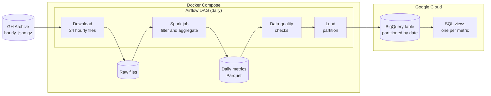
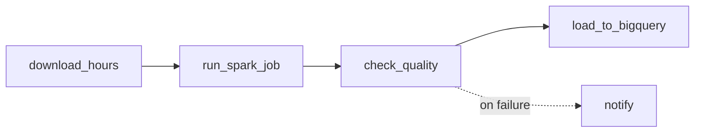

# Dorado

Dorado is a daily batch pipeline that computes the four DORA metrics for a handful of well-known open-source repositories. It reads the public [GH Archive](https://www.gharchive.org/) event stream, aggregates it with PySpark, checks the result, and loads it into BigQuery. Airflow schedules and backfills the runs.

The DORA metrics measure how a team delivers software:

| Metric | Question it answers |
| --- | --- |
| Deployment frequency | How often does the project ship? |
| Lead time for changes | How long does a change take from proposal to merge? |
| Change failure rate | How often does a change need to be undone or fixed? |
| Time to restore | How long does it take to resolve a reported bug? |

## Architecture

All heavy lifting happens locally. Spark reads a full day of raw events, keeps only the configured repositories, and writes a few hundred rows of daily aggregates. Only those aggregates travel to BigQuery. The pipeline never queries the public `githubarchive` dataset in BigQuery, so it stays within the free sandbox.

Each daily run is one Airflow task chain:

A failed check stops the run before anything reaches BigQuery. Each load replaces exactly one date partition, so rerunning or backfilling a day never duplicates data.

