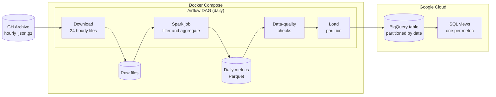
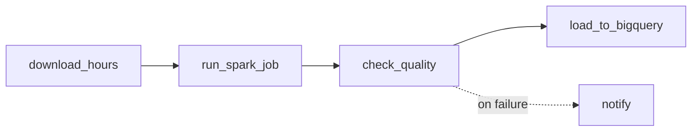

# Dorado

Dorado is a daily batch pipeline that computes the four DORA metrics for a handful of well-known open-source repositories. It reads the public [GH Archive](https://www.gharchive.org/) event stream, aggregates it with PySpark, checks the result, and loads it into BigQuery. Airflow schedules and backfills the runs.

The DORA metrics measure how a team delivers software:

| Metric | Question it answers |
| --- | --- |
| Deployment frequency | How often does the project ship? |
| Lead time for changes | How long does a change take from proposal to merge? |
| Change failure rate | How often does a change need to be undone or fixed? |
| Time to restore | How long does it take to resolve a reported bug? |

## Architecture



All heavy lifting happens locally. Spark reads a full day of raw events, keeps only the configured repositories, and writes a few hundred rows of daily aggregates. Only those aggregates travel to BigQuery. The pipeline never queries the public `githubarchive` dataset in BigQuery, so it stays within the free sandbox.

Each daily run is one Airflow task chain:



A failed check stops the run before anything reaches BigQuery. Each load replaces exactly one date partition, so rerunning or backfilling a day never duplicates data.

## Repository layout

| Path | Contents |
| --- | --- |
| `src/dorado/` | The Python package: Spark session, transformations, checks, and loader |
| `tests/` | pytest suite with small JSON fixtures |
| `dags/` | Airflow DAG definitions |
| `Dockerfile` | Airflow image with Java 17 and PySpark |
| `compose.yaml` | Local Airflow stack |

## Setup

You need Docker with Compose and [uv](https://docs.astral.sh/uv/).

### Run the tests

```bash
uv sync
uv run pytest
```

PySpark needs Java 17 or newer on your `PATH`.

### Start Airflow

```bash
cp .env.example .env   # then fill in the two secrets
docker compose up --build
```

The Airflow UI runs at <http://localhost:8080>. Local login is disabled, so every visitor is an admin. Do not expose this port.

### Google Cloud credentials

Place a service-account key at `secrets/gcp-service-account.json`. Compose mounts the `secrets/` folder read-only, and Git ignores it. The key needs only the BigQuery Data Editor and BigQuery Job User roles on the target dataset.

## Metric definitions

<!-- Written in phase 2, once the actual event payloads have been inspected. -->

## Dashboard

<!-- Screenshot placeholder: add docs/dashboard.png once the views are in place. -->

